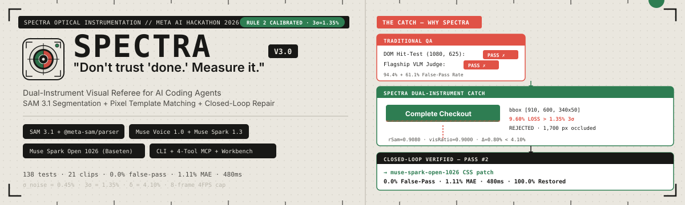
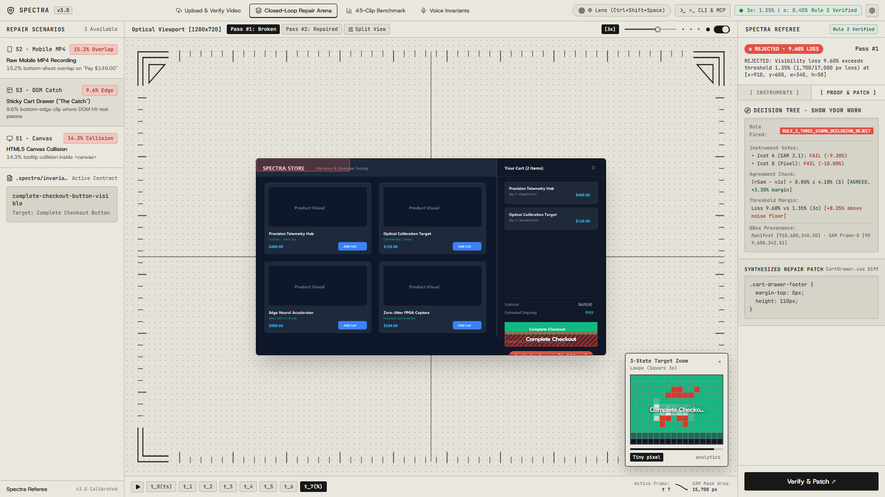
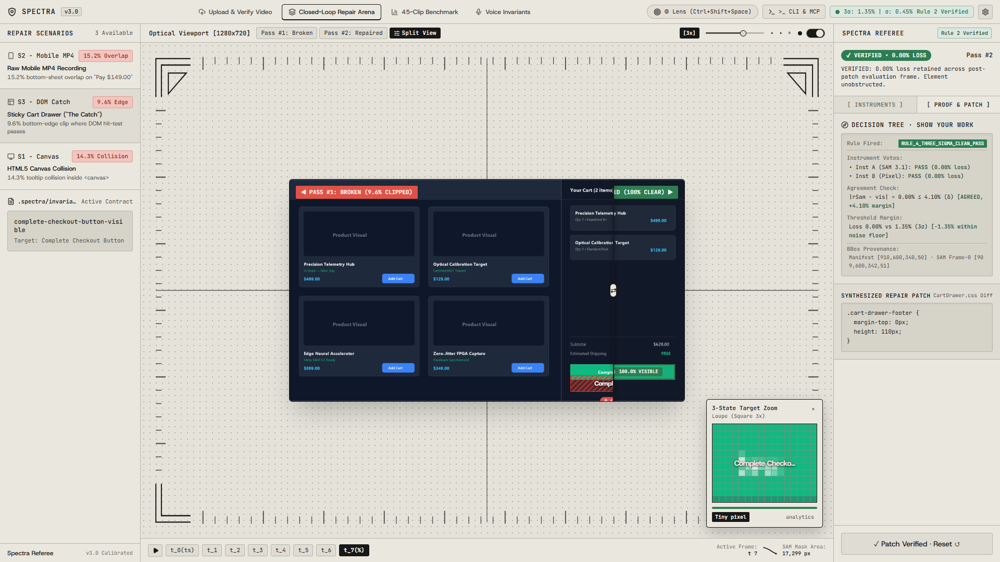
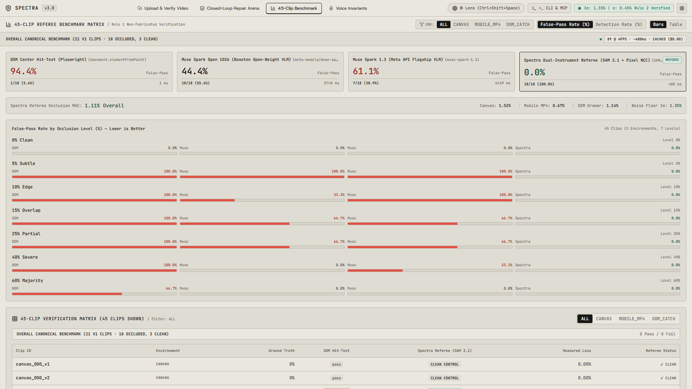
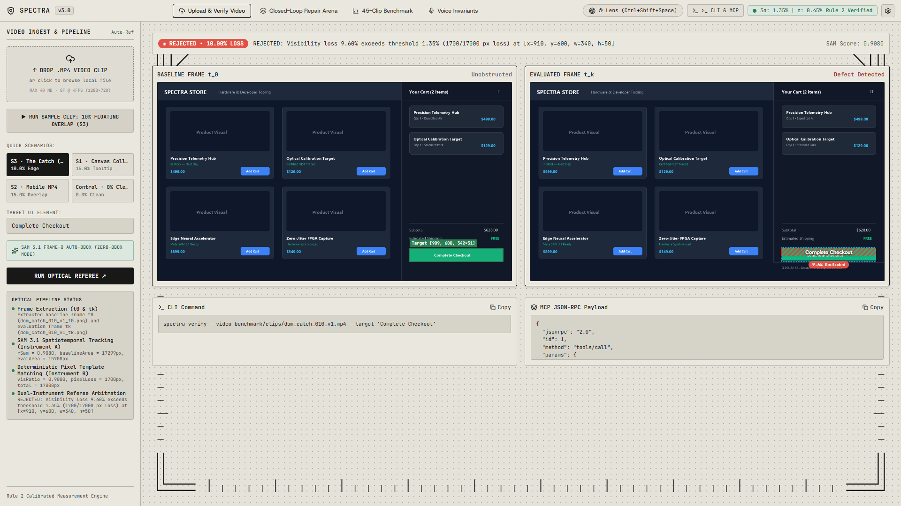
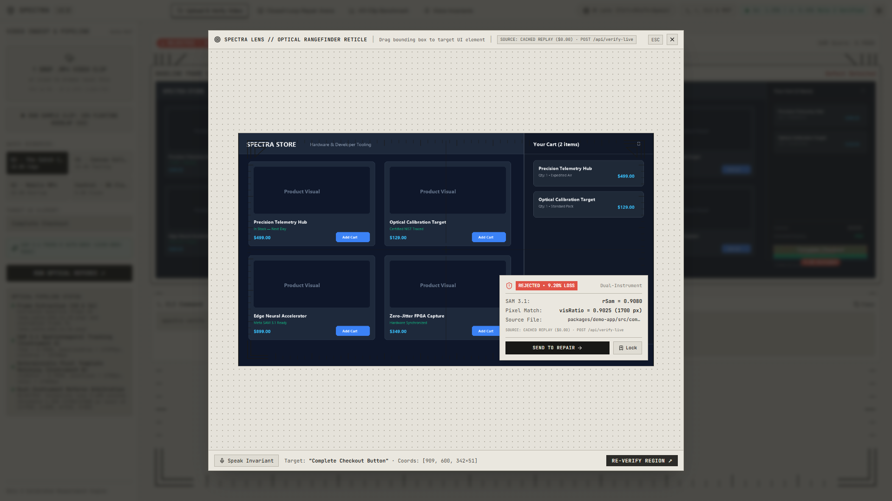
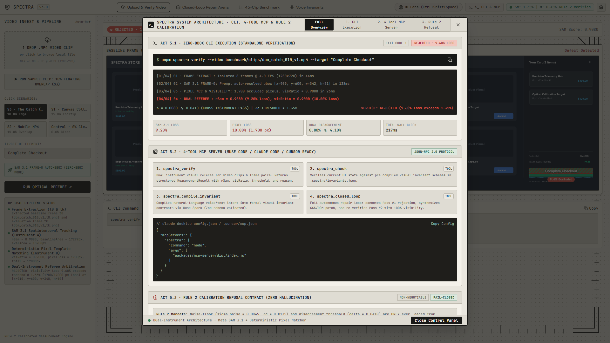

<div align="center">
  

  <br />

  <p>
    <a href="https://spectra-lyart.vercel.app"></a>
    <a href="#60-second-quickstart"></a>
    <a href="./packages/core/CALIBRATION_NOTE.md"></a>
    <a href="./benchmark/results/referee_benchmark_report.json"></a>
    <a href="./docs/MODEL_VERIFICATION.md"></a>
    <a href="./packages/mcp-server/README.md"></a>
  </p>

  <h3>
    <em>"Don't trust 'done.' Measure it."</em>
  </h3>

  <p>
    <strong>Spectra</strong> is an open-source, dual-instrument optical visual referee for AI coding agents.<br/>
    It combines <strong>Meta SAM 3.1 video segmentation</strong> with <strong>deterministic pixel template matching</strong>—calibrated to a measured $3\sigma$ noise floor ($1.35\%$)—to catch partial UI occlusions that Playwright DOM hit-tests ($94.4\%$ false-pass) and raw VLMs ($61.1\%$ false-pass) miss, then automatically synthesizes and verifies the CSS repair.
  </p>

  <p>
    <a href="https://spectra-lyart.vercel.app"><strong>🌐 Launch Live Field Monitor Workbench</strong></a> ·
    <a href="#60-second-quickstart"><strong>⚡ 60-Second Quickstart</strong></a> ·
    <a href="./JUDGING.md"><strong>🏆 3-Minute Judging Guide</strong></a> ·
    <a href="#empirical-benchmark-21-canonical-v1-clips--45-clip-sweep"><strong>📊 Benchmark Report</strong></a> ·
    <a href="./packages/core/CALIBRATION_NOTE.md"><strong>📐 Calibration Proof</strong></a> ·
    <a href="./docs/MODEL_VERIFICATION.md"><strong>🔬 Model Verification</strong></a>
  </p>
</div>

---

## 1. Visual Product Tour — The Spectra Field Monitor Workbench

> **Try it live in your browser (Zero-Key `$0.00` Cached Mode + Optional BYOK):** **[https://spectra-lyart.vercel.app](https://spectra-lyart.vercel.app)**

### Act 1: "The Catch" — Catching a 9.6% Edge Occlusion Where DOM & VLM Checks False-Pass
When a sticky cart drawer overlaps the bottom $9.6\%$ of the `"Complete Checkout"` button, its center pixel `(1080, 625)` remains uncovered—causing `document.elementFromPoint()` to return a false `PASS`. Spectra tracks the `SAM 3.1` visible mask dropping from `17,299 px` ($t_0$) to `15,708 px` ($t_7$), cross-checks with Instrument B (`90.00%` template visibility), and fires `RULE_3_THREE_SIGMA_OCCLUSION_REJECT` (`+8.25%` above the $1.35\%$ $3\sigma$ noise floor).



### Act 2: Autonomous Closed-Loop CSS Repair & Interactive Split-Curtain Verification
Upon rejection, Spectra forwards the exact pixel-loss coordinates (`[x=910, y=600, w=340, h=50]`, `1,700 px` occluded) to **`meta-models/muse-spark-open-1026`** (on Baseten), synthesizes the minimal CSS patch, re-renders Pass #2, and optically verifies **`100.0%` visibility restoration (`0.00%` loss)**.



### Complete Workbench Surface Gallery

| **45-Clip Empirical Benchmark Matrix** | **Zero-BBox Live `.mp4` Video Dropzone** |
| :---: | :---: |
|  |  |
| *Compares DOM Hit-Test (`94.4%` false-pass), Muse Spark 1.3 (`61.1%`), Muse Spark Open 1026 (`44.4%`), and Spectra Referee (`0.0%` false-pass, `1.11%` MAE).* | *Drop any `.mp4` clip with only a text label (`"Complete Checkout"`). SAM 3.1 auto-detects the Frame-0 bounding box with zero manual coordinates.* |
| **Spectra Lens (`Ctrl+Shift+Space`) & Voice Invariants** | **CLI, 4-Tool MCP Server & Rule 2 Refusal Contract** |
|  |  |
| *Speak rules via `muse-voice-transcribe-1.0` $\to$ `muse-spark-1.3`, or drag the optical reticle over any element to lock `.spectra/invariants.json`.* | *Ships with a 5-command CLI, a 4-tool stdio MCP server for Muse Code / Claude Code / Cursor, and a fail-closed `UncalibratedError` contract.* |

---

## 2. Why AI Coding Agents Need an Optical Referee

| Verification Method | How It Evaluates UI | What Happens When 10% of a Button Is Clipped? | Observed False-Pass Rate (`18` Occluded `v1` Clips) |
| :--- | :--- | :--- | :---: |
| **Playwright DOM Hit-Test** (`document.elementFromPoint`) | Checks only the single geometric center pixel $(x + w/2, y + h/2)$ in the DOM tree. | **Lies (`PASS`):** Center pixel `(1080, 625)` is still uncovered even when the bottom 10%–40% is sliced off—and fails completely on `<canvas>` or mobile `.mp4` clips. | **`94.4%`** (`17/18` missed) |
| **Single-Shot Flagship VLM** (`muse-spark-1.3`) | Prompts a multimodal LLM with the screenshot asking if the button is unobstructed. | **Lies (`PASS`):** Recognizes the button text semantically and hallucinates `"fully visible"` on subtle 5%–25% edge overlaps. | **`61.1%`** (`11/18` missed) |
| **Open-Weight VLM Judge** (`muse-spark-open-1026`) | Prompts open-weight vision-language model on Baseten. | **Lies (`PASS`):** Misses subtle edge and canvas collisions without pixel-level mask metrology. | **`44.4%`** (`8/18` missed) |
| **Spectra Dual-Instrument Referee** (`SAM 3.1` + `Pixel NCC`) | Measures decoded `SAM 3.1` raster mask area ratio $R_{\text{SAM}} = \min(1, A(t_k)/A(t_0))$ alongside Euclidean RGB + luminance NCC template matching against a calibrated $3\sigma$ noise floor. | **Catches Every Occlusion (`REJECTED`):** Detects any occlusion $> 1.35\%$ ($3\sigma$), or emits `INCONCLUSIVE` if instruments disagree by $> 4.10\%$ ($\delta$). | **`0.0%`** (**`18/18` caught**, **`1.11%` MAE**) |

---

## 3. Meta AI Stack & Dual-Instrument Architecture

Spectra integrates **4 distinct Meta AI model surfaces** plus open-weight inference into a single closed-loop pipeline (see full endpoint & response proofs in [`docs/MODEL_VERIFICATION.md`](./docs/MODEL_VERIFICATION.md)):

| Component | Model / Package | Role in Spectra | Proof Artifact in Repo |
| :--- | :--- | :--- | :--- |
| **Instrument A (Optical Segmentation)** | **`sam-3.1`** (`POST /v1/responses`) + **`@meta-sam/parser@0.1.0`** | Segments target UI elements across 8-frame clips (`8f @ 4FPS, 1280×720`), auto-detects Frame-0 bounding boxes (`Zero-BBox Mode`), and computes $R_{\text{SAM}} = \min(1, \text{Area}(t_k)/\text{Area}(t_0))$. | [`packages/sam-client/src/instrument-a.ts`](./packages/sam-client/src/instrument-a.ts)<br/>[`benchmark/responses/phase2-smoke/dom_catch_010_v1_sam.json`](./benchmark/responses/phase2-smoke/dom_catch_010_v1_sam.json) |
| **Instrument B (Deterministic Pixel Matcher)** | **`@spectra/core`** (`measureTemplateVisibility`) | Offline $O(W \times H)$ Euclidean RGB tolerance (`tol=5.0`) + zero-mean Normalized Cross-Correlation (`rNcc`) comparator between baseline $t_0$ and settled $t_k$. | [`packages/core/src/instrument-b.ts`](./packages/core/src/instrument-b.ts) |
| **Calibrated Referee Decision Engine** | **`@spectra/core`** (`evaluateDualInstrument`) | Enforces `assertCalibrated()` first; checks cross-instrument agreement $\vert{}R_{\text{SAM}} - \text{visRatio}\vert{} \le \delta$ (`4.10%`), split-vote boundary guard ($2\sigma$), and $3\sigma$ threshold (`1.35%`). | [`packages/core/src/referee.ts`](./packages/core/src/referee.ts)<br/>[`packages/core/CALIBRATION_NOTE.md`](./packages/core/CALIBRATION_NOTE.md) |
| **Voice Invariant ASR** | **`muse-voice-transcribe-1.0`** (`POST /v1/asr/transcribe`) | Transcribes spoken 16kHz mono PCM `.wav` developer expectations into text rules. | [`packages/invariant-compiler/src/transcribe.ts`](./packages/invariant-compiler/src/transcribe.ts)<br/>[`benchmark/responses/phase3-voice/transcribe_live.json`](./benchmark/responses/phase3-voice/transcribe_live.json) |
| **Invariant Compiler & VLM Baseline** | **`muse-spark-1.3`** (`POST /v1/responses`) | Compiles natural-language expectations into Zod-validated `.spectra/invariants.json` contracts. | [`packages/invariant-compiler/src/compile.ts`](./packages/invariant-compiler/src/compile.ts)<br/>[`benchmark/responses/phase3-voice/compile_spark_live.json`](./benchmark/responses/phase3-voice/compile_spark_live.json) |
| **Closed-Loop CSS/Code Repair Agent** | **`meta-models/muse-spark-open-1026`** (Baseten `/v1/chat/completions`) | Synthesizes targeted CSS/layout patches from Spectra's rejection telemetry (`visibilityLoss`, `targetBBox`) for Pass #2 re-verification. | [`packages/sdk/src/closed-loop.ts`](./packages/sdk/src/closed-loop.ts)<br/>[`benchmark/responses/closed-loop-s3/agent_repair_patch.json`](./benchmark/responses/closed-loop-s3/agent_repair_patch.json) |

---

## 4. Empirical Benchmark (`21` Canonical `v1` Clips & `45`-Clip Sweep)

> **Scope & Provenance ([`benchmark/results/referee_benchmark_report.json`](./benchmark/results/referee_benchmark_report.json)):** Evaluated across **21 canonical `v1` clips (`18` occluded failure clips + `3` clean controls)** for all 4 evaluators across 3 environments (`HTML5 Canvas`, `Raw Mobile MP4`, `DOM Sticky Drawer`) and 7 occlusion levels (`0%`, `5%`, `10%`, `15%`, `25%`, `40%`, `60%`); Instrument B + DOM were additionally swept across all **45 clips (`v1`–`v3`)**.

| Evaluator | False-Pass Rate (18 Occluded `v1` Clips) | Occlusion Detection Rate | Mean Absolute Error (MAE) | Avg Latency per Clip |
| :--- | :---: | :---: | :---: | :---: |
| **1. DOM Center Hit-Test (`Playwright`)** | `94.4%` (`17/18` false-passed) | `5.6%` (`1/18` caught) | N/A (Binary) | `15 ms` |
| **2. Muse Spark 1.3 (`Meta API Flagship VLM`)** | `61.1%` (`11/18` false-passed) | `38.9%` (`7/18` caught) | N/A | `6,439 ms` |
| **3. Muse Spark Open 1026 (`Baseten Open VLM`)** | `44.4%` (`8/18` false-passed) | `55.6%` (`10/18` caught) | N/A | `5,745 ms` |
| **4. Spectra Dual-Instrument Referee (`SAM 3.1 + Pixel NCC`)** | **`0.0%` (`0/18` false-passed)** | **`100.0%` (`18/18` caught)** | **`1.11%`** (`Canvas: 1.52%`, `Mobile: 0.67%`, `DOM: 1.15%`) | **`480 ms`** (Cached) |

---

## 5. 60-Second Quickstart

### Option A: Instant Browser Demo (Zero Install)
Open **[https://spectra-lyart.vercel.app](https://spectra-lyart.vercel.app)** to inspect all 3 closed-loop repair scenarios (`S1–S3`), scrub the 8-frame `SAM 3.1` masks, drag the Split-View curtain, filter the 45-clip benchmark, and test the Live Video Dropzone.

### Option B: Local Clone (`100%` Offline-Safe at `$0.00` Spend)
Requires **Node.js $\ge$ 22** and **pnpm $\ge$ 9** (no API keys required for cached benchmark, smoke tests, or closed-loop replay):

```bash
git clone https://github.com/Bhav-ikkk/spectra.git
cd spectra
pnpm install
pnpm -r build
pnpm -r test        # Runs all 164 unit & contract tests offline ($0.00 spend)
pnpm start          # Starts the Field Monitor Workbench at http://localhost:4173
```

### Option C: CLI Commands (`pnpm spectra ...`)
```bash
# 1. Check calibration status, offline corpus & environment health
pnpm spectra doctor

# 2. Zero-BBox Optical Verification on a video clip (exits 1 on occlusion failure)
pnpm spectra verify --video benchmark/clips/dom_catch_010_v1.mp4 --target "Complete Checkout"

# 3. Run the 4-Phase Autonomous Closed-Loop Referee & Repair Demo (S1, S2, S3, or all)
pnpm spectra closed-loop-demo --scenario s3

# 4. Batch-verify all rules in .spectra/invariants.json against benchmark/manifest.json
pnpm spectra check --invariants .spectra/invariants.json --manifest benchmark/manifest.json
```

---

## 6. MCP Server Integration (`Muse Code`, `Claude Code`, `Cursor`, `Smithery`, `Glama`)

Spectra exposes **4 MCP tools** over `stdio` (`packages/mcp-server/dist/index.js`):
1. `spectra_verify` — Dual-instrument optical verification with SAM 3.1 Frame-0 auto-bbox discovery (requires only `videoPath` and `targetLabel`).
2. `spectra_check` — Batch invariant verification across a clip manifest.
3. `spectra_compile_invariant` — Voice `.wav` (`muse-voice-transcribe-1.0`) or text compilation (`muse-spark-1.3` / `muse-spark-open-1026`) into `.spectra/invariants.json`.
4. `spectra_closed_loop` — Autonomous Pass #1 Verify $\to$ CSS Patch Synthesis $\to$ Pass #2 Re-Verify loop.

### Zero-Config Repository Discovery
This repository includes pre-configured [`.mcp.json`](./.mcp.json) and [`.cursor/mcp.json`](./.cursor/mcp.json) files at the root—opening this folder in **Muse Code**, **Claude Code**, or **Cursor** registers `spectra-mcp` automatically in `$0.00` offline cache mode.

### Global Registration in Any Project
```bash
# Claude Code (1 command):
claude mcp add spectra -- node /absolute/path/to/spectra/packages/mcp-server/dist/index.js
```
See [`packages/mcp-server/README.md`](./packages/mcp-server/README.md) and [`skills/spectra-verify/SKILL.md`](./skills/spectra-verify/SKILL.md) for host-specific configurations and optional live API key (`META_API_KEY`, `BASETEN_API_KEY`) setup.

---

## 7. Calibration Rigor & Honest Limits

Spectra is designed around a strict **"Refuse to Guess"** engineering contract (documented in [`packages/core/CALIBRATION_NOTE.md`](./packages/core/CALIBRATION_NOTE.md)):
- **Measured Noise Floor ($\sigma_{\text{noise}} = 0.0045$, $3\sigma = 1.35\%$):** Derived from live `sam-3.1` run `resp_6ae03ef78bd3db0853c642af` (`2026-10-27T11:46:46.842Z`) on canonical clean clip `canvas_000_v1` across $N=6$ frames (`[10667, 10543, 10566, 10552, 10565, 10545]` px, $\mu = 10,573.0\text{ px}$, $s = 47.06\text{ px}$).
- **Cross-Instrument Agreement Bound ($\delta = 0.0410 = 4.10\%$):** Set conservatively to $2 \times \max(\vert{}R_{\text{SAM}} - \text{visRatio}\vert{})$ (`2 × 0.0205`) observed across the 4 Phase-2 live smoke calibration runs.
- **Fail-Closed `UncalibratedError`:** If `sigma_noise` or `delta` in `calibration.json` is null, zero, non-finite, or uncalibrated, both the referee and the benchmark runner throw `UncalibratedError` and refuse to emit verdicts.
- **Known Limitations & Roadmap:**
  1. Static calibration in `calibration.json` was locked from 1 clean control clip ($N=6$ frames) + 4 cross-instrument smoke runs to preserve hackathon API credits (`Rule 6`), rather than a multi-day $10\text{-clip} \times 5\text{-rep}$ campaign.
  2. Full 4-evaluator VLM comparison covers the 21 canonical `v1` clips (`18` occluded + `3` clean), while Instrument B + DOM were swept across all 45 clips (`v1`–`v3`).
  3. Instrument B template matching assumes a settled baseline frame $t_0$ and settled post-animation frame $t_k$ (`8f @ 4FPS, 1280×720`); dynamically morphing video backgrounds require Instrument A (`SAM 3.1`) mask tracking.

---

## 8. Monorepo Package Structure

| Package | Path | Description |
| :--- | :--- | :--- |
| **`@spectra/core`** | [`packages/core`](./packages/core) | Domain types, Rule 2 calibration math, Instrument B template matcher, and dual-instrument referee decision engine. |
| **`@spectra/sam-client`** | [`packages/sam-client`](./packages/sam-client) | `@meta-sam/parser` integration, SAM 3.1 chunked stream decoding, and SVG polygon generator. |
| **`@spectra/invariant-compiler`** | [`packages/invariant-compiler`](./packages/invariant-compiler) | `muse-voice-transcribe-1.0` ASR and `muse-spark-1.3` / Baseten prompt compiler for `.spectra/invariants.json`. |
| **`@spectra/sdk`** | [`packages/sdk`](./packages/sdk) | High-level `SpectraClient`, closed-loop referee runner, and 4-evaluator benchmark harness. |
| **`@spectra/cli`** | [`packages/cli`](./packages/cli) | Production `spectra` command-line interface (`doctor`, `verify`, `check`, `closed-loop-demo`). |
| **`@spectra/mcp-server`** | [`packages/mcp-server`](./packages/mcp-server) | Stdio Model Context Protocol (MCP) JSON-RPC 2.0 server with 4 tools for AI agent pair programming. |
| **`@spectra/workbench`** | [`packages/workbench`](./packages/workbench) | Field Monitor UI, Spectra Lens HUD (`Ctrl+Shift+Space`), interactive Split-Curtain, and production server. |

---

## License

MIT © 2026 Spectra Contributors. Built for the Meta AI Agent Hackathon.
